# 🎓 Graduation Studio

**A full-stack web platform for graduation event planning and management.**  
*Previously known as Graduation Planner.*

[🌐 Live Platform](https://4zelei.com) · [📂 Public Case Study](https://github.com/Yazdan-97/graduation-studio-case-study)

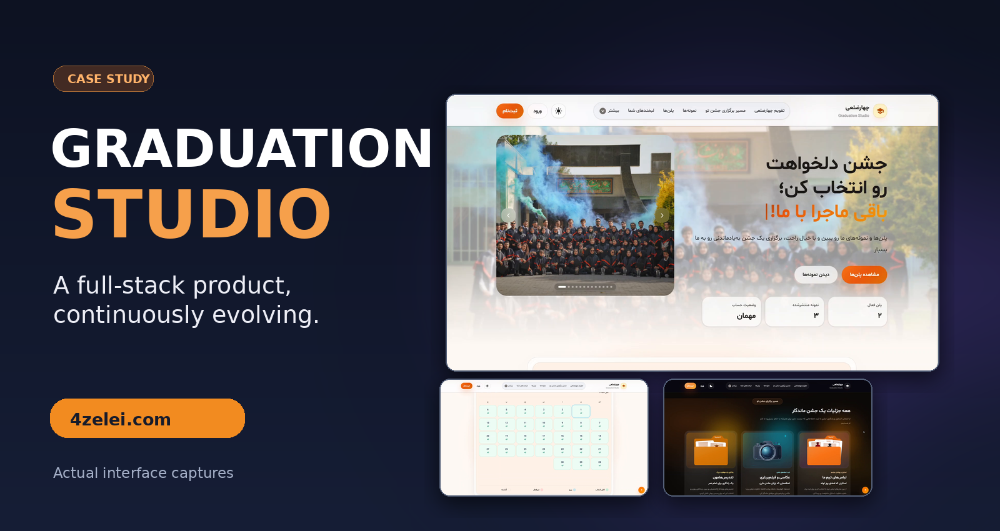

> **About this repository:** This is a public product and engineering case study. The production application's source code is private and is not included in this repository.

## Overview

Graduation Studio is a production-deployed web application designed to simplify how graduation celebrations are explored, planned, and managed. It brings user-facing event planning workflows and administrative operations into a single platform.

The project has evolved since its initial release, including a refreshed identity and ongoing refinements to its interface and user experience. This repository documents the product, technical approach, and development work.

## Key capabilities

### User experience

- Explore event plans and package details.
- Browse event samples when available.
- Check date availability using an interactive calendar.
- Register and sign in to a user account.
- Submit event requests and manage reservation-related activity.
- Access account settings and profile management.
- Use the platform across desktop and mobile screens.
- Switch between light and dark themes.

### Administration

- Manage users and administrative access.
- Create and update event plans, samples, and site content.
- Review and manage incoming requests and reservations.
- Monitor request status and reservation availability.
- Configure website content and system settings.

### Application foundations

- Authentication and session management.
- Role-based access control and protected administrative routes.
- Server-side application logic and authorization.
- Relational data modeling and database access.
- Responsive interface and maintainable application components.

## Technology stack

| Layer | Technologies |
| --- | --- |
| Frontend | Next.js, React, TypeScript, Tailwind CSS |
| Backend | Next.js / Node.js, server-side application logic |
| Database | PostgreSQL, Prisma ORM |
| Development | Git, GitHub, npm |

## High-level architecture

```text
Browser / Responsive UI
         |
         v
Next.js + React (TypeScript)
         |
         v
Application Logic + Authentication + Authorization
         |
         v
      Prisma ORM
         |
         v
      PostgreSQL
```

This diagram is a high-level conceptual overview, not an exhaustive infrastructure diagram.

## My contributions

I worked on the platform across the product lifecycle, including:

- Responsive UI implementation and iterative visual improvements.
- Reusable frontend components and interactive event-planning workflows.
- Server-side application logic and administrative functionality.
- Authentication, role-based authorization, and protected user journeys.
- Database design and integration with Prisma and PostgreSQL.
- Deployment, production maintenance, and ongoing refinements.

## Visual walkthrough

The following screenshots and motion previews are captured from the public-facing Graduation Studio application. Explore the latest version on the [live website](https://4zelei.com).

### Homepage and interactive calendar

| Homepage | Event availability calendar |
| :---: | :---: |
| 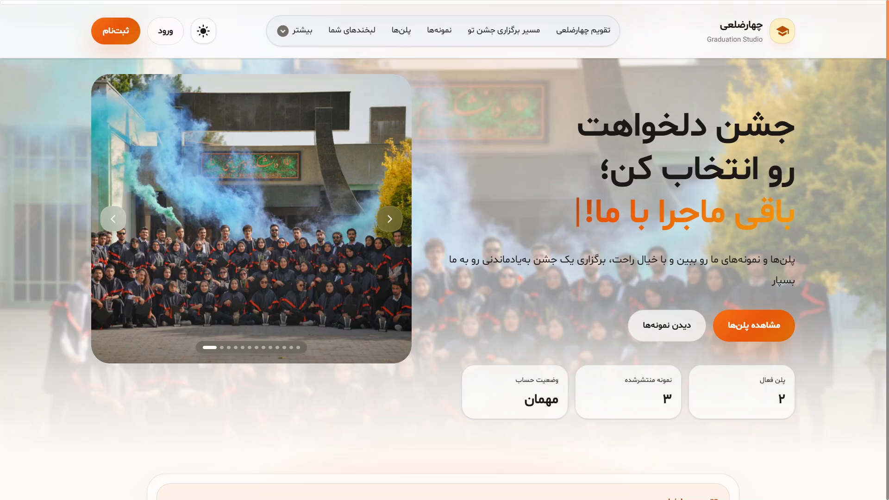 | 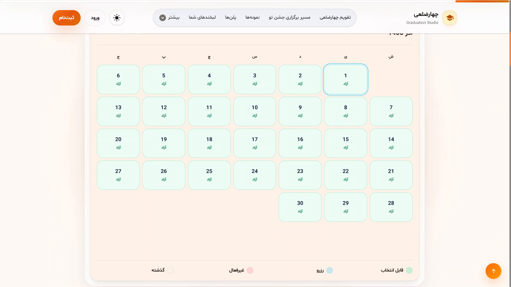 |

### Discover plans and explore details

| Planning experience | Available event plans |
| :---: | :---: |
| 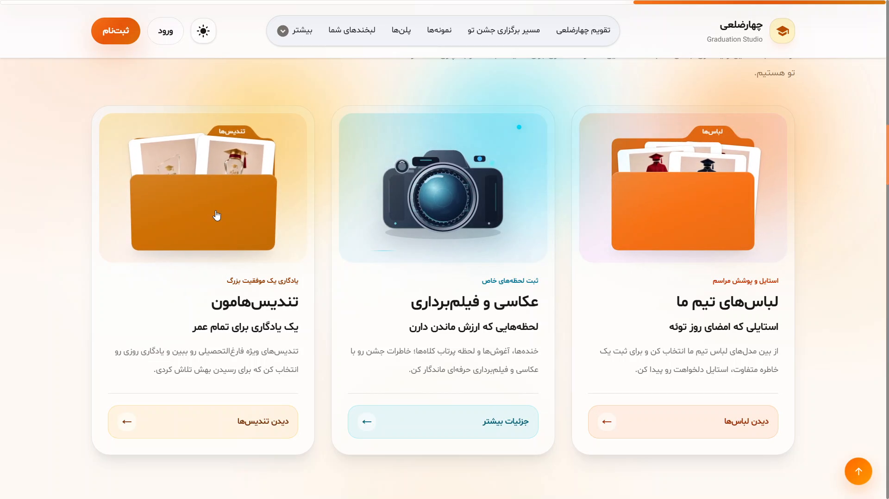 | 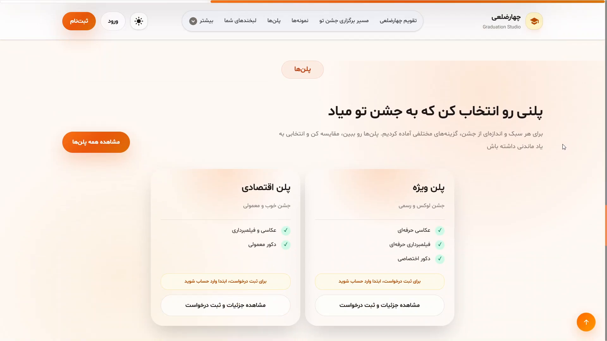 |

| Event plan details | Visual gallery |
| :---: | :---: |
| 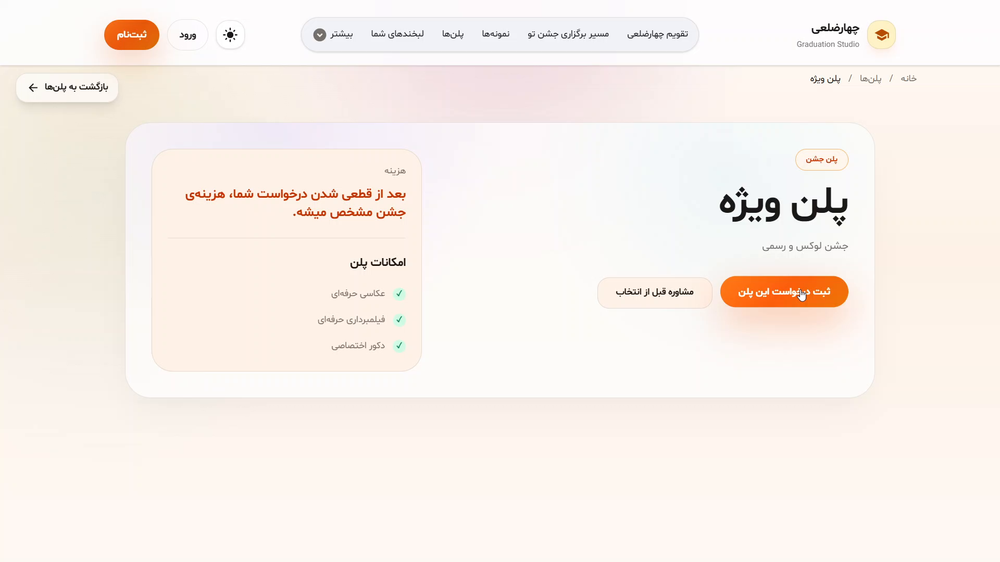 | 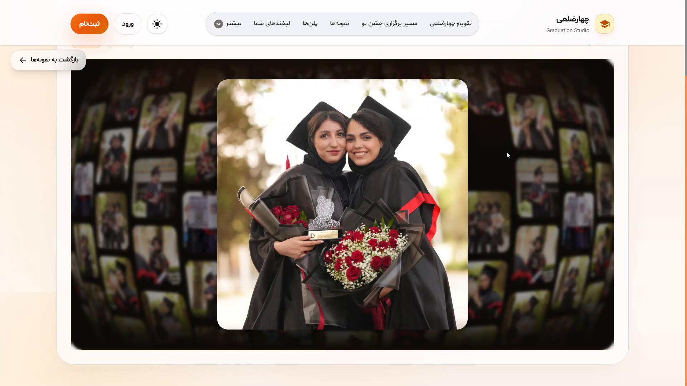 |

### Account experience and dark mode

| Sign-in interface | Dark theme |
| :---: | :---: |
| 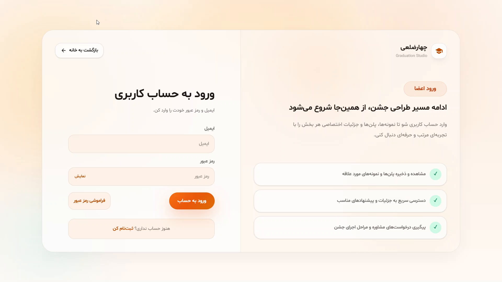 | 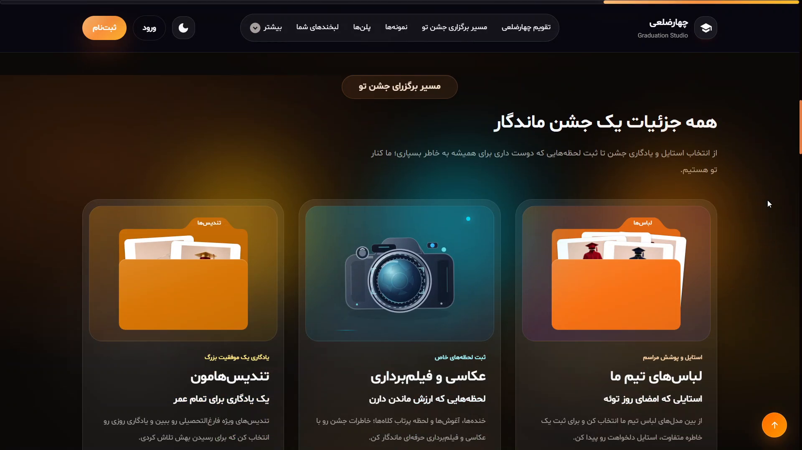 |

### 🎬 Interactions in motion

**Interactive gallery:** Opening a photo preview and viewing the selected item.

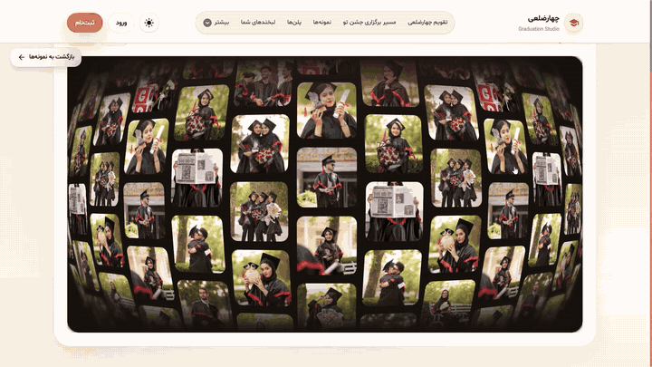

**Theme switching:** Transitioning between the light and dark interfaces.

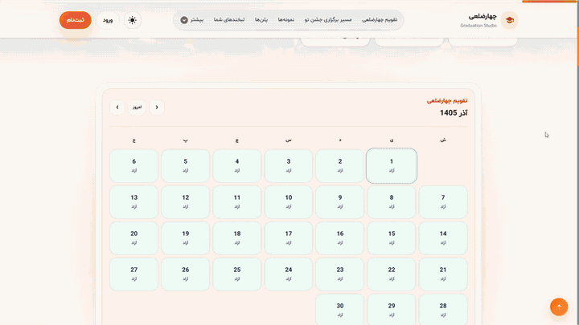

> **Visual documentation:** These captures show public-facing screens. Administrative dashboards and private account data are intentionally excluded. Any future authenticated or administrative screenshots should use synthetic demo data and must not expose customer information, email addresses, credentials, or tokens.

## Current status

**Live and evolving.** Graduation Studio continues to be refined as product and operational needs change.

## Source code and confidentiality

The production application's source code is **private** due to project ownership and confidentiality considerations. This public repository is a portfolio case study containing project information and visual documentation; it does **not** contain the complete application source code.

---

**Live:** https://4zelei.com  
**Project identity:** Graduation Studio (formerly Graduation Planner)
